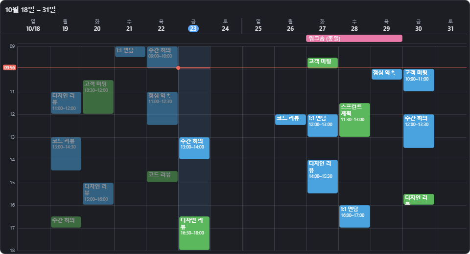
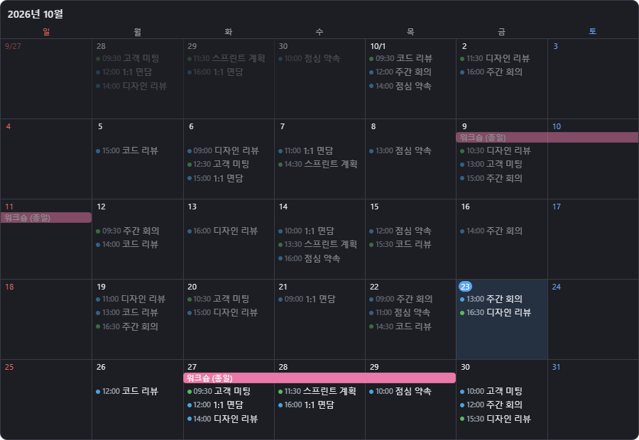
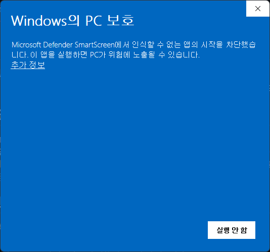
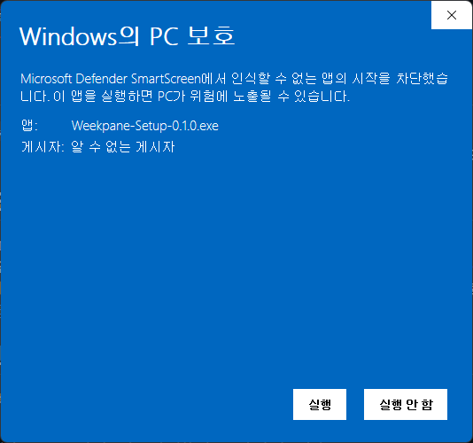
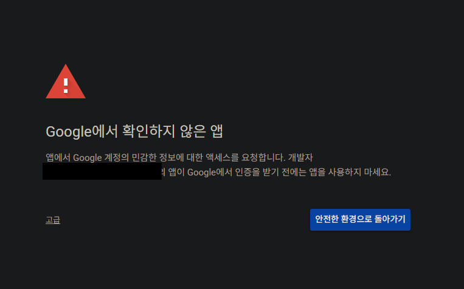
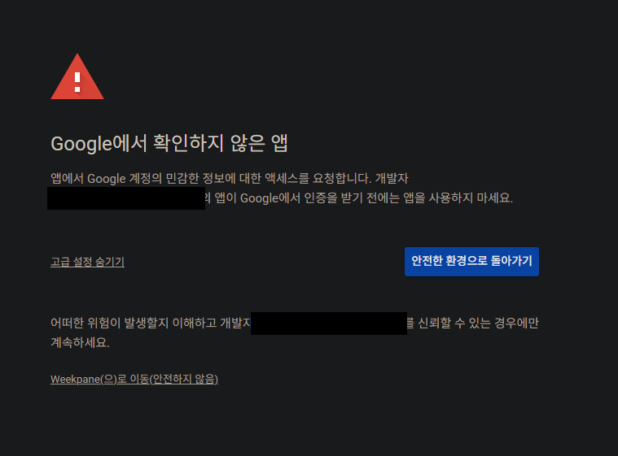
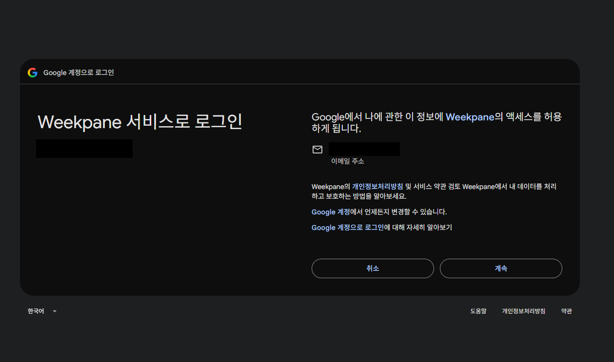
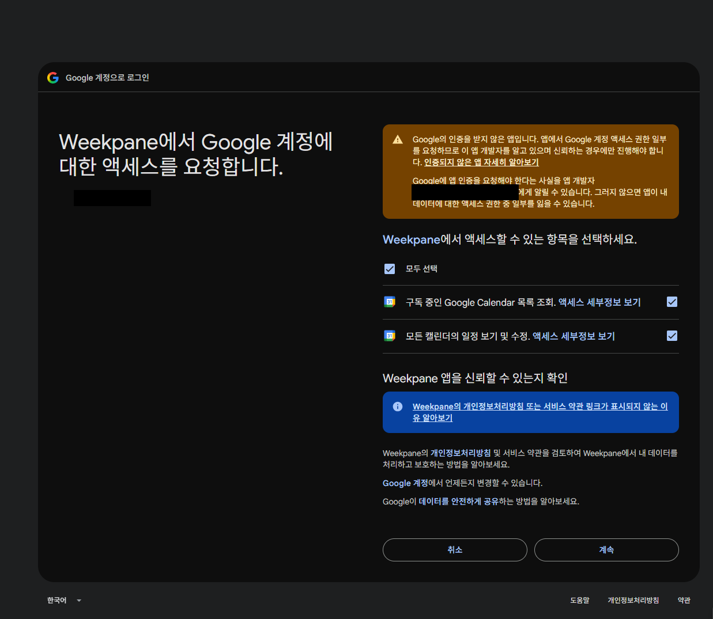

# Weekpane

구글 캘린더·Outlook 일정을 Windows 11 바탕화면에 **시간표처럼** 띄우는 위젯입니다.

- 주별(1~3주) · 월별 · 일별 보기, 위젯을 원하는 만큼 동시에 배치
- 주별 보기는 요일별 시간표에 일정이 칠해지고, **현재 시각**이 빨간 가로선으로 표시됩니다
- 다른 창 바로 아래(바탕화면 위)에 고정되고, **Win+D(바탕화면 보기)에도 사라지지 않습니다**. 투명도는 배경과 일정 색 모두에 적용됩니다
- 구글 로그인으로 일정 **추가 · 수정 · 삭제**, 구글에서 지정한 캘린더 색상 표시
- 제목별 색상 규칙, 다크/라이트 테마, 투명도, 글자 크기, 부팅 시 자동 실행

## 이런 앱입니다

바탕화면에 일정표를 항상 띄워두는 위젯입니다. 아래는 샘플 일정으로 만든 화면이고, 실제 일정은 계정을 연동하면 채워집니다.

**주별 보기 (2주, 시간표 형식)** — 요일별 시간표에 일정이 칠해지고, 오늘 칸과 현재 시각(빨간 가로선)이 표시됩니다.

**월별 보기** — 한 달 일정을 한눈에 보고, 여러 날에 걸친 종일 일정은 막대로 이어집니다.

> 이 저장소는 설치 파일과 사용 안내를 배포하는 곳입니다.

## 설치

1. [Releases](https://github.com/SeonYoo-Kim/Weekpane/releases)에서 최신 `Weekpane-Setup-x.y.z.exe`를 받아 실행합니다.
2. **"Windows의 PC 보호"** 화면이 나오면 아래 순서로 진행하세요. 설치 파일에 코드 서명이 없어서 나오는 화면이고,
   Weekpane만의 문제가 아닙니다.
   1. 본문의 **추가 정보**를 누릅니다. (이때는 버튼이 **실행 안 함** 하나뿐입니다.)
   2. 앱 이름(`Weekpane-Setup-…exe`)과 게시자(`알 수 없는 게시자`)가 보이고 **실행** 버튼이 새로 생깁니다.
      **실행**을 누릅니다. (**실행 안 함**을 누르면 설치가 취소됩니다.)

      
      
3. 설치가 끝나면 위젯이 바탕화면에 나타나고 작업표시줄 오른쪽(트레이)에 아이콘이 생깁니다.

## 계정 연동

설정 창은 위젯에 마우스를 올렸을 때 나오는 **⚙** 버튼이나 트레이 아이콘 클릭으로 엽니다.
아래 세 가지 방법 중 하나를 고르세요. 함께 써도 됩니다.

### 방법 1. 구글 로그인 (권장)

일정 보기 + 추가/수정/삭제, 구글에서 지정한 캘린더 색상까지 모두 쓸 수 있습니다.

**로그인 순서** — 브라우저에 아래 화면이 차례로 나옵니다. 중간에 경고 화면이 나오는 것은 정상입니다.

1. **Weekpane 설정 창**에서 **구글 로그인**을 누릅니다. 버튼이 "브라우저에서 로그인 중…"으로 바뀌고 기본 브라우저가 열립니다.
2. **계정 선택** 화면에서 일정이 있는 구글 계정을 고릅니다. 목록에 없으면 **다른 계정 사용**을 누르세요.
3. **"Google에서 확인하지 않은 앱"** 화면 (빨간 경고 아이콘)
   - 왼쪽 아래의 작은 **고급** 링크를 누릅니다.
   - 펼쳐진 아래쪽의 **Weekpane(으)로 이동(안전하지 않음)** 을 누릅니다.
   - 파란 큰 버튼 **안전한 환경으로 돌아가기**는 로그인을 취소하는 버튼이니 누르지 마세요.
   - 이 화면은 Weekpane이 구글의 앱 인증을 받지 않아서 나옵니다. 화면에 보이는 개발자 이메일은 이 앱을 만든 사람의 연락처입니다.

   
   

4. **"Weekpane 서비스로 로그인"** 화면 — 내 이메일 주소를 확인하는 단계입니다. **계속**을 누릅니다.

   
5. **"Weekpane에서 Google 계정에 대한 액세스를 요청합니다"** 화면 (위쪽에 주황색 "Google의 인증을 받지 않은 앱입니다" 안내)
   - **모두 선택**이 체크되어 있고 아래 두 항목도 모두 체크된 상태를 **그대로 두세요.**
     - 구독 중인 Google Calendar 목록 조회
     - 모든 캘린더의 일정 보기 및 수정
   - 두 번째 항목(일정 보기 및 수정)의 체크를 풀면 Weekpane이 일정을 읽을 수 없습니다.
   - 확인했으면 **계속**을 누릅니다. (**취소**를 누르면 로그인이 중단됩니다.)

   

6. 브라우저에 **"로그인되었습니다. 이 창을 닫아도 됩니다."** 가 나오면 브라우저를 닫습니다.
7. Weekpane 설정 창에 **● (내 이메일) 로그인됨**이 표시되고, 위젯에 일정이 나타납니다. 안 나오면 위젯 우클릭 → **새로고침**.

**로그인이 안 될 때**
- 브라우저에서 오류가 나거나 창을 닫아버려 설정 창이 "로그인 중…"에서 멈추면 **취소**를 누른 뒤 **구글 로그인**을 다시 누르세요.
  (아무것도 안 해도 3분 뒤에 자동으로 풀립니다.)
- "액세스 차단됨" 화면이 나오면 [이슈](https://github.com/SeonYoo-Kim/Weekpane/issues)로 알려 주세요. 앱의 게시 설정 문제일 수 있습니다.
- 5단계에서 실수로 일정 권한을 빼고 진행했다면, 설정에서 **로그아웃** 후 다시 로그인하면서 두 항목을 모두 체크하세요.
  필요하면 [구글 계정 → 타사 앱 액세스](https://myaccount.google.com/permissions)에서 Weekpane을 삭제하고 처음부터 다시 하세요.

**참고**
- 요청하는 권한은 **캘린더 일정 보기·수정**과 **캘린더 목록 보기**, 로그인한 이메일 표시뿐입니다.
- 로그인 정보는 내 PC의 Windows 암호화 저장소(`safeStorage`)에만 저장되고 외부 서버로 보내지 않습니다.
- 로그아웃은 설정의 **로그아웃**, 권한 회수는 [구글 계정 → 보안 → 타사 앱 액세스](https://myaccount.google.com/permissions)에서 할 수 있습니다.

> 인증 전 앱은 구글 정책상 로그인할 수 있는 사용자 수에 제한(약 100명)이 있습니다.
> 로그인이 안 되면 아래 방법 2(ICS 링크)를 쓰거나, 아래 *고급: 내 구글 키 사용*을 따라 직접 만든 키를 입력하세요.

### 방법 2. ICS 링크 (로그인·키 없이, 읽기 전용)

일정을 보기만 하면 되고 가장 간단합니다. 반영이 조금 늦을 수 있고(최대 동기화 주기, 기본 10분) 위젯에서 수정은 안 됩니다.

- **구글 캘린더**: 설정(톱니) → 내 캘린더 설정 → 해당 캘린더 → **캘린더 통합** → "iCal 형식의 비공개 주소" 복사
- **Outlook 웹**: 설정 → 캘린더 → 공유 캘린더 → **캘린더 게시** → ICS 링크 복사 (회사 정책으로 막혀 있을 수 있음)

Weekpane 설정의 **ICS 캘린더**에 이름과 주소를 붙여넣고 **추가**합니다.
이 주소는 **아는 사람은 누구나 일정을 볼 수 있는 비밀 링크**이니 공유하지 마세요.
반복 일정, 일부 회차만 바뀐 일정, 종일·여러 날 일정, 시간대를 처리합니다.

### 방법 3. Microsoft(Outlook) 로그인

Outlook 일정을 로그인으로 읽습니다(읽기 전용). Azure에서 앱을 직접 등록해야 하고, 회사 계정은 정책에 따라
**IT 관리자의 동의**가 필요할 수 있습니다. 어렵다면 방법 2(ICS)를 권합니다.

1. [Azure 포털](https://portal.azure.com) → Microsoft Entra ID → 앱 등록 → 새 등록
2. 계정 유형: 사용하는 계정에 맞게 선택 (회사 계정이면 "이 조직 디렉터리의 계정만")
3. 리디렉션 URI: 플랫폼 **모바일 및 데스크톱 애플리케이션**, 값 `http://localhost`
4. 인증 → **설정** 탭 → "공용 클라이언트 흐름 허용"을 **예**
5. API 사용 권한 → Microsoft Graph → 위임된 권한: `Calendars.Read`, `User.Read`
6. 개요의 **애플리케이션(클라이언트) ID**를 Weekpane 설정의 *Microsoft 계정*에 입력 → 저장 → Microsoft 로그인

개인 Microsoft 계정(outlook.com)은 Azure 디렉터리가 없으면 앱 등록이 안 됩니다. 이 경우도 방법 1이나 2를 쓰세요.

### 고급: 내 구글 키 사용

사용자 수 제한에 걸리거나 내 키로 쓰고 싶을 때만 필요합니다.

1. [Google Cloud 콘솔](https://console.cloud.google.com)에서 프로젝트를 만들고 **Google Calendar API**를 사용 설정합니다.
2. Google Auth Platform에서 대상 **외부**, 앱 이름과 지원 이메일을 입력하고 **테스트 사용자**에 본인 계정을 추가합니다.
   데이터 액세스에는 `calendar.events`, `calendar.calendarlist.readonly` 범위를 등록하세요.
3. 클라이언트 만들기 → 유형 **데스크톱 앱** → **클라이언트 ID / 보안 비밀**을 복사합니다.
4. Weekpane 설정 → 구글 로그인 → **고급: 내 Client ID 사용**에 입력하고 저장한 뒤 구글 로그인을 누릅니다.

테스트 상태의 앱은 로그인이 7일마다 풀립니다. 오래 쓰려면 대상 화면에서 **프로덕션으로 게시**하세요(개인용은 심사가 필요 없습니다).

## 사용법

- **일정 추가**: 빈 곳을 **더블클릭**(또는 위젯 헤더의 ＋). 구글 로그인이 되어 있어야 합니다.
- **일정 수정·삭제**: 일정을 **클릭**. 반복 일정은 해당 회차만 바뀝니다. 읽기 전용 캘린더(공휴일 등)와 ICS/Outlook 일정은 수정할 수 없습니다.
- **위젯 우클릭**: 보기(주 1/2/3주·월·일), 주별 표시 형식(시간표/목록), 시간 범위, 테마, 투명도, 글자 크기, 주차 번호, 고정/해제, 닫기
- **위치·크기 바꾸기**: 우클릭 → *고정 해제* 후 헤더를 끌어 이동, 오른쪽 아래 모서리를 끌어 크기 조절, 🔒로 다시 고정
- **트레이 아이콘**: 위젯 추가(주/월/일), 모두 고정/해제, 지금 동기화, 설정, 종료
- **색상**: 설정에서 캘린더별 색을 바꾸거나 *제목별 색상 규칙*(제목에 특정 글자가 들어가면 지정한 색)을 추가합니다.

## 알려진 제한

- 구글 캘린더의 **새 색상 팔레트**(망고, 유칼립투스 등)는 구글 API가 알려주지 않아 읽을 수 없습니다. *제목별 색상 규칙*으로 맞출 수 있습니다.
- Windows 11 기준입니다. 위젯을 다른 창 아래에 두고 Win+D 때만 위로 올리는 방식이라, 다른 Windows 버전에서는 동작이 다를 수 있습니다.
- 설치 파일은 코드 서명이 없어 처음 실행할 때 SmartScreen 경고가 나옵니다.
- **구글 로그인(방법 1)은 사용자 100명까지만 가능합니다.** 이 앱은 구글의 인증(검증)을 받지 않은 상태라 구글이 "확인되지 않은 앱"으로 취급하고, 이런 앱은 로그인할 수 있는 사용자 수가 총 100명으로 제한됩니다(한 번 쓴 계정도 수에서 빠지지 않습니다).
  100명을 넘으면 새 사용자는 구글 로그인이 거부될 수 있습니다.
  그런 경우에는 **방법 2(ICS 링크)** 나 **방법 3(Microsoft 로그인)**, 또는 **고급: 내 구글 키 사용**으로 쓰면 이 제한과 상관없이 쓸 수 있습니다.

## 개인정보

- 일정 데이터는 구글/Microsoft/ICS 서버와 **내 PC 사이에서만** 오가며, 제3자 서버는 없습니다.
- 설정은 `%APPDATA%\Weekpane\config.json`, 로그인 토큰은 같은 폴더의 암호화된 파일에 저장됩니다. 앱을 지우고 이 폴더를 삭제하면 모두 사라집니다.
- 자세한 내용은 [개인정보처리방침](PRIVACY.md)을 참고하세요.

---

© Weekpane. 모든 권리 보유.
